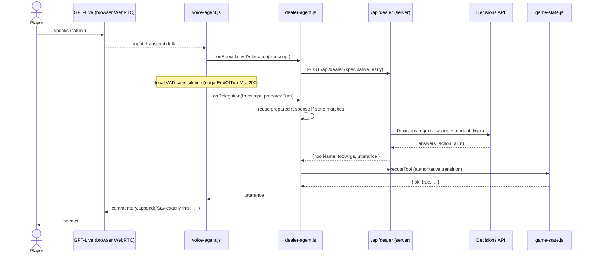

# RoboDeal — how it works

This document describes exactly how RoboDeal is built today: the two AI models,
the flow of a spoken turn, the deterministic poker engine, the server routes, and
the payments layer. It is the implementation companion to
[`model-layering.md`](./model-layering.md), which explains the design rationale.

## 1. The one-line summary

RoboDeal is a browser app for a shared physical poker table. Players speak; a
realtime speech model listens and talks; a reasoning model classifies what the
player meant; and a JavaScript state machine — never a model — decides and
applies every game action.

Three authorities, in order:

| Layer | Code | Authority |
| --- | --- | --- |
| Speech model | GPT-Live 1 (`gpt-live-1`) | Hears audio, speaks approved text |
| Reasoning model | Decisions API (`gpt-6-luna`) | Proposes an intent; never mutates state |
| State machine | `game-state.js` | The only thing that changes the game |

## 2. The two AI models

Both models are called through the server (`openai-api.js`), which holds the
OpenAI key. The browser never sees the key.

### 2.1 GPT-Live 1 — the voice layer

- Created by `POST /api/live-session` → `createLiveSession` →
  `https://api.openai.com/v1/live/sessions`.
- The browser connects to it over **WebRTC directly** (the server only relays the
  SDP offer/answer). See `voice-agent.js` `connect()` (voice-agent.js:162).
- Request shape (`openai-api.js:12`): model `gpt-live-1`, `delegation: { type:
  'client' }`, `audio.output.voice`, and `instructions` from
  `Prompts.json.liveInstructions` (with `{{ACCENT}}`/`{{PACE}}` filled in).
- Its job: transcribe speech, detect end-of-utterance, delegate intelligible
  utterances to the client, and speak back exact lines the backend approves.
- It is told (Prompts.json) to **never** decide poker rules, answer game-state
  questions, invent narration, or backchannel while a delegation is pending.

Communication with GPT-Live uses the WebRTC data channel `oai-events`. The
events the app consumes (`voice-agent.js` `handleEvent`, voice-agent.js:700+):

| Event | Meaning |
| --- | --- |
| `session.created` / `session.started` | Session is live |
| `session.input_transcript.delta` | Streaming transcript of the player |
| `session.delegation.created` (target `client`) | Model wants the backend to handle a turn |
| `session.output_transcript.delta` / `.done` | Model's spoken reply (used to open/close the output gate) |

The app sends back:

- `session.commentary.append` — the line the model should say. `speak()`
  (voice-agent.js:238) wraps it as `"Say exactly this: <line>"`.
- `session.thinking.append` — silent context (never spoken).
- `session.instructions.append` — system-style instruction.

### 2.2 Decisions API — the reasoning layer

- Called by `POST /api/dealer` → `runDealerTurn` (`dealer-brain.js`) →
  `createDecisionsResponse` → `https://api.openai.com/v1/decisions`.
- Model name comes from `Questions.json.model` (`gpt-6-luna`).
- One request contains:
  - **input**: `decisionsInstructions` + the current game state as JSON + the
    player's transcript (`decisions.js` `buildDecisionInput`);
  - **questions**: a bounded set of multiple-choice / predicate / score
    questions (`decisions.js`).
- It returns typed answers. It cannot execute anything.

## 3. End-to-end flow of one spoken turn

### 3.1 Hearing and turn-taking (`voice-agent.js`)

- The mic is added to the WebRTC sender (`startMicrophone`, voice-agent.js:286).
- A **local VAD** polls the mic RMS (`pollInputVad`, voice-agent.js:322). When
  the player stops for `eagerEndOfTurnMs` (200 ms), the app commits the turn
  without waiting for the server to detect silence.
- **Speculation**: as soon as transcript deltas arrive, the app calls
  `onSpeculativeDelegation` → `DealerAgent.prepare()` (dealer-agent.js:32), which
  fires `/api/dealer` early with the partial transcript. If the final transcript
  matches and the state is unchanged, the prepared answer is reused — this hides
  most of the reasoning latency.
- The **output gate** keeps the model muted until approved commentary is
  supplied, then opens only when the model's `output_transcript` is authorized
  (this suppresses backchannels/filler).

### 3.2 The dealer turn (`dealer-agent.js`)

`DealerAgent.runTurn` (dealer-agent.js:65):

1. Build the current state snapshot and a fingerprint.
2. If a prepared turn matches (same `sourceEvent` + same state), reuse it;
   otherwise `POST /api/dealer`. Records `serverMs` / `speculativeLeadMs`.
3. `markVoiceStage('decisionReady')`.
4. If the state changed meanwhile, ignore (stale) — `staleStateIgnored`.
5. If the response has a `toolName`, execute it via `executeVoiceTool` in
   `app.js` (a validated `game-state.js` transition). `markVoiceStage('gameActionApplied')`.
6. On success → return the utterance; on failure → a second `/api/dealer` call
   with `toolOutput` asking for a grounded clarification.

Turns are serialized through a promise queue (dealer-agent.js:22).

### 3.3 Deciding (`dealer-brain.js` + `decisions.js`)

`runDealerTurn` (dealer-brain.js:167) has three branches:

- **Non-voice events** (`game_started`, `new_hand_started`, `state_transition`)
  are narrated **locally** — no model call, no charge.
- **`toolOutput` present** → produce a rejection/clarification line.
- **A voice utterance** → call the Decisions API:

  `decisions.js` builds questions for the model:
  - `action` — one of `check, call, bet, raise, fold, allIn, cardsDealt, undo,
    nextHand, pickWinner, narrateValues, nothing` (`Questions.json.action`);
  - `raise_target` — `raiseTo` vs `raiseBy`;
  - `amount_digit_<place>` — the stated number, one digit per decimal place
    (e.g. hundreds/tens/ones), reassembled by `digitsToNumber`.
  - `value_<name>` — which state values the player asked to hear.

  `readPokerDecision` reads the answers; `reconcileRaiseTarget` fixes up
  raise-to vs raise-by ambiguity against the legal bounds. `PICK_WINNER` makes a
  second Decisions call (`winnerQuestions`) to pick the winning player(s).
  Finally `toolCallFor` maps the action to a tool (`check/call/fold/allIn/
  bet/raise/cardsDealt/undo/nextHand/chooseWinner/splitPot`).

### 3.4 Narration (`decisionsToText.js`)

The dealer's spoken line is authored by **application code**, not the model:

- `decisionsToText.js` is a table of sentence builders keyed by facts
  (`rejected.*`, `event.*`, `winner`).
- `pickDecisionToTextFunction(facts)` routes to the right builder (or
  `undefined`).
- `dealer-brain.js` `narrationFor` uses the picker; for plain action results it
  falls back to a generic `"<actor> <action> … . The pot is <n>."` line.

The resulting string is what `speak()` hands to GPT-Live. GPT-Live only delivers
it.

## 4. The poker engine (`game-state.js`)

- Exposes `GamePhase` and `Transition` enums (game-state.js:3) and the
  `executeTransition(state, action)` function.
- Owns players, stacks, blinds, dealer button, current player, betting round,
  pots, and hand phase.
- `pot-logic.js` computes pots, side pots, betting-round completion, and the
  maximum legal additional bet.
- Betting limits: no-limit, pot-limit, and fixed-limit (with a configurable
  raise cap). Edge cases handled: returning an uncalled bet, cumulative short
  all-ins reopening the action, and fixed-limit half-bet reopen.

`app.js` is the only caller that mutates state: `invokeGame()` (app.js:354)
records undo state, runs the transition, and — when narrating — emits a
`state_transition` dealer turn so the table is announced even when the change
came from a button.

## 5. Server routes (`api/`)

All routes use `openai-api.js` helpers for JSON body parsing and error
responses. Expensive routes are rate-limited (`rate-limit.js`, in-memory
fixed-window per IP + payer).

| Route | Purpose |
| --- | --- |
| `POST /api/live-session` | Create the GPT-Live WebRTC session (charges `LIVE_SESSION_START_CENTS`) |
| `POST /api/dealer` | Run a dealer turn; charges `DEALER_TURN_CENTS` only for a billed Decisions call |
| `GET/POST /api/balance` | Current payer balance |
| `POST /api/topup` | Create a Stripe PaymentIntent ($5–$1000) |
| `POST /api/topup-status` | Confirm a PaymentIntent and credit the balance |
| `POST /api/debit` | Debit usage (client-reported) |
| `POST /api/save-card` | Create a Stripe SetupIntent to save a card |
| `POST /api/claim-free` | Grant the free hours (once per card fingerprint) |
| `GET /api/ui-prompts` | Serve non-secret UI strings (`thinkingSilence`, preview text) |

In local dev, `vite.config.mjs` mounts the same handlers as Vite middleware,
plus two localhost-only debug routes: `/api/debug/zero-balance` and
`/api/debug/grant`.

## 6. Payments and metering (`payments.js`)

- **Identity**: an anonymous HttpOnly cookie `payer` (a UUID) — `ensurePayerId`.
- **Storage**: Supabase tables `balances(payer_id, balance_cents, updated_at)`,
  `ledger(payer_id, delta_cents, reason, ref)` (unique `ref`), and
  `granted_fingerprints(fingerprint pk, payer_id, created_at)`. RLS is on with no
  public policies; only the server (secret key) reads/writes.
- **Prices**: `PRICE_CENTS_PER_HOUR = 400` ($4/hr). Live session start =
  `ceil(400 × 15 / 3600)` = 2¢; each dealer turn = 1¢. Free grant =
  `INITIAL_FREE_HOURS (2) × 400` = 800¢.
- **Atomic debit**: `debitIfAvailable` does a compare-and-set on
  `balance_cents` (retries on contention) and writes a ledger row.
- **Top-up**: Stripe PaymentIntent → `/api/topup-status` verifies
  `metadata.payer_id` and credits the balance (idempotent via the ledger `ref`).
- **Free grant**: `/api/claim-free` verifies a succeeded SetupIntent, reads the
  card fingerprint, and inserts it into `granted_fingerprints` (unique) — so the
  free credit is one-per-card, not one-per-cookie.

## 7. Config files

- **`Prompts.json`** (restricted): `liveInstructions` (voice layer role),
  `decisionsInstructions` (reasoning layer role), `voicePreviewInstructions`,
  `voicePreviewText`, `previewGreeting`, `thinkingSilence`.
- **`Questions.json`** (restricted): the Decisions model name, `narrationPrefix`,
  the action choices and transition mapping, `raiseTarget`, `amount` digit
  questions, the `values` the dealer can report, and `winner` questions.

## 8. Latency telemetry

`voice-agent.js` and `dealer-agent.js` record timing into
`window.__robodealLatencyHistory` (`recordVoiceLatency`), including `queueMs`,
`serverMs`, `javascriptMs`, `speculativeLeadMs`, and `totalBackendMs`. Named
stage markers (`window.__robodealVoiceStages`) are written via `markVoiceStage`
at `decisionReady` and `gameActionApplied`.

The benchmark scripts use these markers:

| Script | What it measures |
| --- | --- |
| `ai-speed-test.mjs` | Decisions request speed |
| `ai-voice-speed-test.mjs` | Voice-model speed |
| `ai-e2e-latency.mjs` | Speech→action end to end (no browser) |
| `ai-human-latency.mjs` | Real mic + recorded fixtures in a headless browser |
| `ai-pie-latency.mjs` | Splits the human run into pie slices |

## 9. File map

| File | Role |
| --- | --- |
| `index.html`, `styles.css`, `app.js` | UI, table, game wiring, tool execution, metering |
| `voice-agent.js` | GPT-Live WebRTC transport, transcripts, local VAD, output gate |
| `dealer-agent.js` | Serialized dealer turns, speculation, tool execution |
| `dealer-brain.js` | Turn orchestration + narration composition |
| `decisions.js` | Decisions question construction and answer reading |
| `decisionsToText.js` | Facts → spoken sentence builders |
| `game-state.js`, `pot-logic.js`, `seat-order.js`, `game-settings.js` | Poker engine |
| `openai-api.js` | OpenAI request builders and response parsing |
| `api/*.js` | Serverless routes |
| `payments.js`, `rate-limit.js` | Billing and throttling |
| `Prompts.json`, `Questions.json` | Model instructions and Decisions config |
| `vite.config.mjs` | Dev server + local `/api` middleware |

## 10. Known gaps

- **State revisions**: `model-layering.md` calls for a monotonic `stateRevision`
  checked against every AI mutation. Today the app compares a state
  *fingerprint* before applying (dealer-agent.js:101), which catches most stale
  turns but is not the full contract.
- **Client-reported metering**: `/api/debit` trusts the client; the server-side
  gates are on `/api/live-session` and `/api/dealer`.
- **Rate limiting** is in-memory per serverless instance, not shared.
